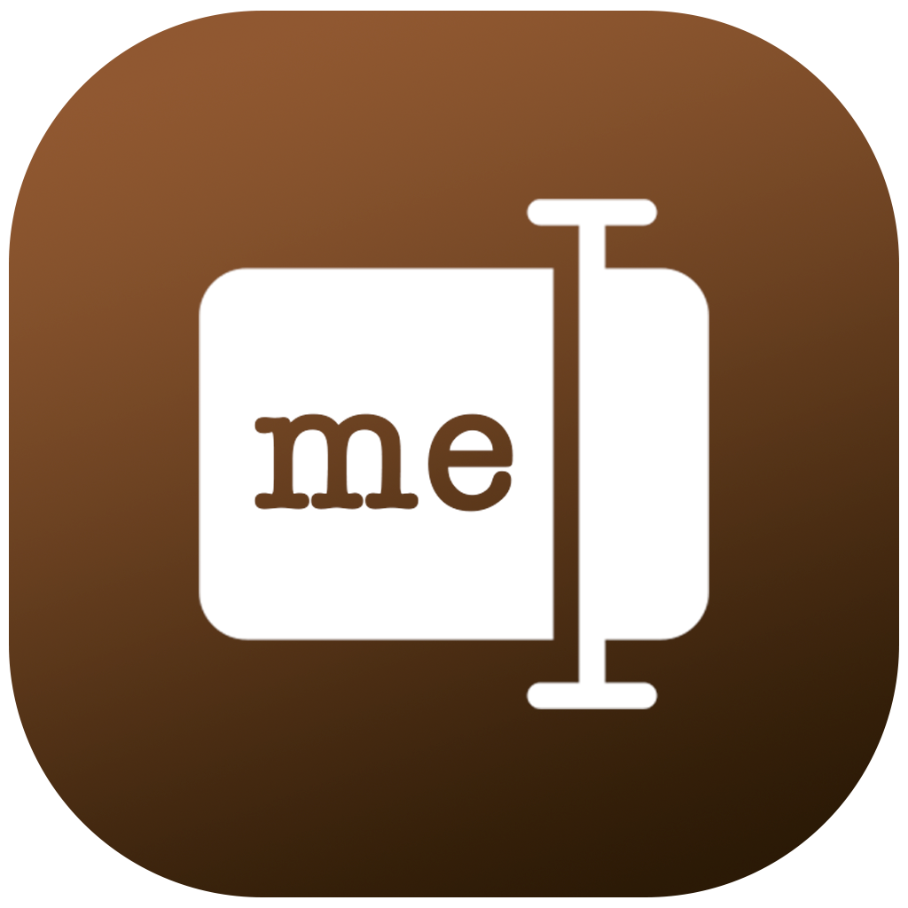
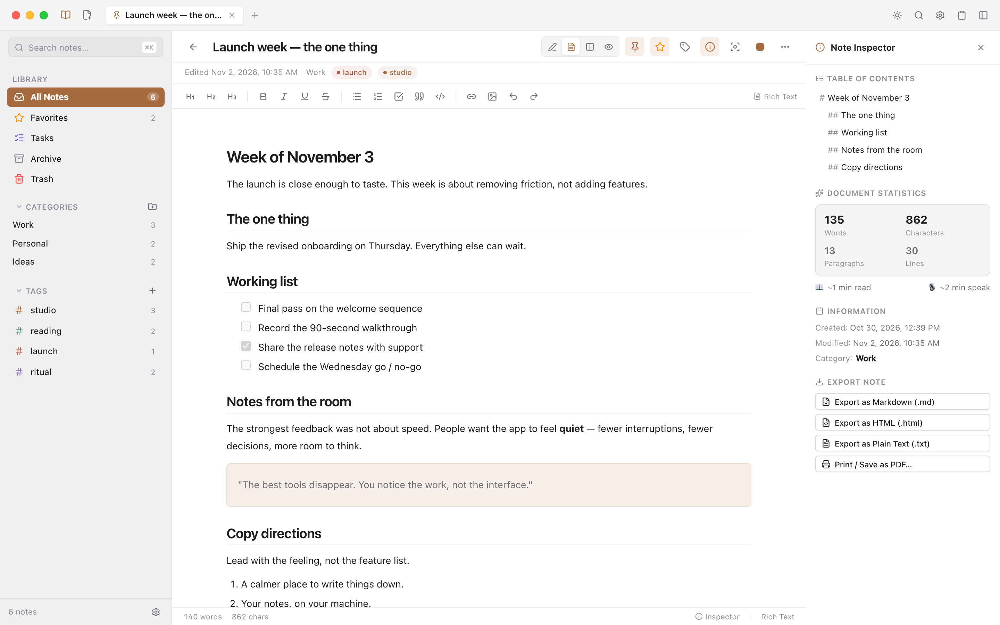
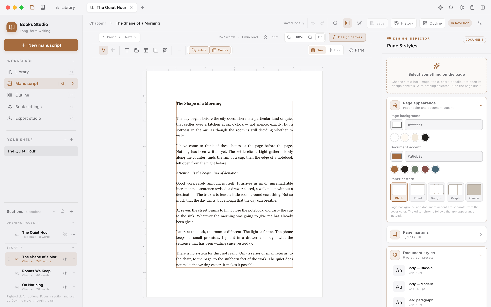

<div align="center">
  
  <h1>NoteMe</h1>
  <p><strong>A quiet, local-first home for your notes and manuscripts.</strong></p>
  <p>Think clearly. Write deeply. Keep everything on your machine.</p>

  <p>
    <a href="https://github.com/kidddevs/note-me/releases"></a>
    
    
    
    
  </p>

  <p>
    <a href="#install">Install</a> ·
    <a href="#notes">Notes</a> ·
    <a href="#books-studio">Books Studio</a> ·
    <a href="#build-from-source">Build</a> ·
    <a href="#data-and-privacy">Privacy</a>
  </p>
</div>

---

NoteMe is an open-source desktop app for notes and long-form writing. It pairs a fast Markdown workspace with **Books Studio**, a full page-design surface for manuscripts — all in one native app. There is no account, cloud dependency, tracking, or required sync service. Your work lives in a local SQLite database and stays on your machine.

## A look inside

<p align="center">
  
</p>
<p align="center"><em><strong>Notes.</strong> Markdown and rich text, browser-style tabs, categories, tags, tasks, and a live document inspector.</em></p>

<p align="center">
  
</p>
<p align="center"><em><strong>Books Studio.</strong> A direct-manipulation manuscript canvas with typography, page layout, and publishing tools.</em></p>

## Why NoteMe

- **Private by default.** Notes are stored locally in SQLite; attachments stay on disk. No telemetry, no account, no server round-trips.
- **Fast enough to stay out of the way.** A keyboard-first interface, browser-style tabs, instant search, and a command palette for everything.
- **Built for depth.** Markdown, rich text, tasks, categories, tags, attachments, clipboard history, and full-text search in one workspace.
- **A real writing studio.** Books Studio adds structured manuscripts, custom page geometry, editorial typography, and reader-ready export.
- **At home on your desktop.** Native menus, window state, global Quick Capture, system themes, and a Tauri 2 shell on macOS, Windows, and Linux.
- **Your data stays portable.** Notes remain usable as plain Markdown instead of being trapped in a proprietary format.

## Notes

The notes workspace is designed for the way thoughts actually arrive: quickly, in fragments, and often while you are doing something else.

- **Write your way.** Markdown edit, split, and preview modes; rich text editing with headings, emphasis, lists, task lists, quotes, code, and links. Switching modes preserves the Markdown source.
- **Organize lightly.** All Notes, Favorites, Tasks, Archive, and Trash views; color-coded categories; tags with live counts; full-text search and command-palette navigation.
- **Keep moving.** Browser-style tabs with drag-to-reorder and middle-click close; pin, favorite, archive, restore, duplicate, and batch-manage notes.
- **Capture anything.** Global Quick Capture with `Cmd+Shift+N`, clipboard history with `Cmd+Shift+V`, and Daily Note, Meeting, and Journal templates.
- **Attach without friction.** Paste or drag images into a note; files are copied into local storage and referenced from Markdown.
- **Take it with you.** Import `.md`, `.markdown`, and `.txt` files, export Markdown/HTML/plain text, or print through the native flow.

## Books Studio

Books Studio is a second workspace in the same app, opened from the titlebar book icon or **View → Books Studio**. Manuscript data is kept separate from your notes, and each book remembers its own place in the manuscript.

### Structure and writing

- Search the library by title, author, genre, or stage. Filter by publishing stage with live counts and sort by recency, progress, title, or creation date. Cards show the full saved cover spread and link directly to the manuscript, cover designer, book settings, and Export Studio.
- Starter templates for novels, nonfiction, magazine issues, newsletters, photo books, and recipe collections, each with a real section sequence and page system.
- Typed manuscript sections — title page, cover, masthead, contents page, editor's letter, feature, department, column, profile, interview, review, photo essay, recipe, listing, advertisement, colophon, and traditional book matter.
- Front matter, story, and closing pages can be reordered, hidden from the table of contents, and managed from the rail or context menu.
- Distraction-reduced writing surface with H1–H6 formatting, focus mode, section statistics, find and replace, writing sprints, and automatic local saves.
- Section-level undo and redo, plus automatic and manual version checkpoints you can preview, restore, or delete.
- Reader metadata for title, subtitle, author, genre, description, status, cover color, trim size, and word goal.
- **Section plan** with Draft/Revising/Ready status, individual word budgets and local-calendar due dates. Search and filter the manuscript, sort deadlines, open a section directly for writing, and edit its plan from the manuscript status button. Planning persists separately from writing/page design and stays out of reader exports; the outline and Export Studio reflect saved readiness.

### Design canvas

- InDesign-style **Flow** and **Free** layout modes. Flow keeps text in document order; Free turns the content area into an artboard.
- Text boxes, artwork, tables, charts, and callouts can be positioned freely, resized from eight handles, snapped to margins, layered front/back, and arranged with edge or center alignment.
- One-click editorial inserts for kickers, standfirsts, bylines, pull quotes, captions, section labels, cover lines, folios, and contributor bios, with the editorial style kit added automatically when needed.
- **Section page masters** for cover, feature, department, contents, full-bleed, and colophon pages. Choose **Book** or **This section** in the page inspector, apply a suggested master, and keep every other section inheriting the book. Custom pages are marked in the section rail, a page can be applied to every section of the same kind, and each section can set its own running header, footer, and page-number range.
- **Full-wrap cover studio** with a Photoshop-style artboard for the back cover, spine, and front cover. Start from six complete wrap templates save your own reusable templates that reflow across trim sizes, or import/export shareable `.bookcover` design files, then work with draggable/resizable/rotatable layers; a 23-face type library plus any installed font override, with fit-to-frame sizing, curved display text, and adjustable highlight markers; images, solid and gradient fills with six curated presets and a reverse control, a fourteen-shape library (including shields, tickets, banners, leaves, and arrows), rules, ornaments, and ISBN barcodes; layer visibility, locking, duplication, ordering, opacity, and blend modes; collapsible layer groups with inherited visibility and locking, live layer thumbnails, layer search, cross-cover copy/paste, drag-to-group, inline renaming, grouping/ungrouping selected layers, a right-click layer menu with stacking/group/lock/visibility actions, and new layers joining the active group; an image lab with seven graded looks, brightness/contrast/saturation/hue/blur, duotone tinting, focal-point cropping with direct in-frame photo panning, circle/arch/diamond/hexagon masks, flip controls, and a persistent local image library for reusing uploads across panels and books; an eyedropper, a reusable document palette, one-click palette extraction from any photo, and saved brand palettes for series-wide colour consistency; sixteen blend modes; grid snapping when the grid is visible; non-destructive drop shadows, outer glows, gradient fade masks, and true shape clipping masks on any layer; reusable layer styles with ⌥⌘C/⌥⌘V copy-paste and a saved style library; eight tiling pattern fills with ink, paper, scale, and angle controls; Shift-click multi-selection with align and distribute tools; smart snapping to layer edges and guides; draggable rulers, persistent custom guides, safe areas, bleed, grid, zoom, preview, keyboard nudging, a searchable-by-eye `?` shortcuts and tools guide, and undo/redo with a visible, clickable history timeline in the Layers/History side panel that persists across sessions for each book. Spine width is calculated from the page count and paper stock (or a custom override), the ISBN is generated as a scannable EAN-13 barcode on the back cover by default (or you can upload a barcode image), and every layer can be moved freely. Download the full wrap or the front, back, and spine separately at 150/300 DPI, export image or PDF proofs with an optional diagonal proof watermark, a true single-page PDF with crop marks, fold marks, a colour bar, a print slug, and an optional PDF/X-4 sRGB output intent with trim/bleed boxes, preview a draggable paperback or hardcover 3D book mockup for presentation and client review, export it as square, wide, story, or transparent marketing PNGs, run a live print preflight for ISBN, barcode size/placement, bleed, safe-zone, spine, image sources, and effective image DPI with one-click fixes for barcode, safe-zone, spine-type, low-resolution images, cover-inclusion, and check-digit findings, download a production ZIP with the print PDF, panel exports, mockup, a spec sheet, and a preflight report, print the wrap from the browser, and include an enabled cover in HTML/EPUB exports.
- Shift-click multi-selection, group dragging, alignment guides, zero-height insertion previews, rulers, margin guides, fit-to-width, and stable canvas zoom from 25–200% with buttons, keyboard shortcuts, trackpad pinch, or `Cmd`/`Ctrl`-scroll.
- Cover selections resize and rotate as a composition, with numeric group bounds, proportional text/effect scaling, and cancellable gestures. Page and cover selections share edge/center alignment and equal-gap/equal-center spacing; page selections survive arrange undo/redo and Flow/Free mode changes.
- Right-click any text frame, artwork, table, chart, or callout for contextual editing, duplication, layering, movement, deletion, and full-bleed commands. Right-click the page for canvas tools.
- A contextual design inspector with role typography, paragraph presets, character controls, hyphenation, columns, tabs, drop caps, nested openings, rules, borders, shading, bullets, numbering, and GREP styling.
- Editorial typography controls for ligatures, oldstyle/lining/tabular figures, hanging punctuation, last-line alignment, widows and orphans, keep-lines, page breaks, and a non-printing baseline grid with one-click leading snap.
- Paper patterns and presets: blank, ruled, dot grid, graph, and planner pages with configurable rule color and spacing, plus one-click Manuscript, Journal, Notebook, Planner, and Sketchbook setups.
- **Free margins** unlock full-bleed text and artwork beyond the content margins. Individual objects can opt into full bleed, and artwork can carry its own background color to override the page background.
- Measurement units are switchable between **inches, centimeters, and pixels** across page sizes, margins, rulers, pattern spacing, and settings while staying stored in print-safe inches.
- A searchable artwork drawer with local images and recolorable editorial artwork — ornaments, dividers, botanicals, symbols, frames, lines, shapes, arrows, and a dedicated Journal set with cards, trackers, labels, washi tape, pockets, stamps, and photo corners. Artwork inserts at a sensible width for its role, and an existing artwork can be replaced directly from the collection.
- **Shared studio image library** for manuscript pages, cover layers and image backgrounds, with search, favorites, orientation filters, tags, alt text, photo credits and source notes. Save an existing image back to the shelf, retain placed artwork when removing a library copy, and reuse identical uploads without duplicate entries. Page images share the cover's focal crop preview, while image replacements preserve the frame and caption. Credits travel into HTML, EPUB, print and Word, and cover production packages include an image-credits report.
- Editorial page systems for magazines, newsletters, lookbooks, zines, annual reports, and recipe books, plus an opt-in editorial style kit with kickers, standfirsts, bylines, section labels, cover lines, folios, contributor bios, and contents entries.
- Portable rich blocks for GFM tables, configurable tables, bar / line / area / donut / stat charts, callouts, and graph fences — all embedded in the manuscript Markdown.

### Publishing

- Custom trim sizes for trade books, digest and zine formats, newsstand magazines, catalogues, portfolios, A4, and US Letter.
- Running headers and footers with `{{title}}`, `{{author}}`, `{{section}}`, `{{page}}`, `{{volume}}`, `{{issue}}`, `{{season}}`, `{{year}}`, and `{{issueLine}}` tokens, with per-section slots and previews in the canvas and export studio.
- Flexible page numbering with automatic sequences or manual range starts, Arabic or Roman styles, custom formats, placement, and per-section overrides.
- Generated contents with configurable title, H1–H6 depth, matter inclusion, and per-heading visibility.
- Export to **EPUB 3, DOCX, styled HTML, Markdown, and plain text**, or use the system print dialog for a PDF proof. Named paragraph styles and section page masters travel into HTML, EPUB, and print. EPUB and HTML can include the front cover, while print can include the full spread.
- Choose cover and contents for each export, preview the cover, interior, contents or source, and review the package summary before saving. Preflight links back to settings, sections, and Outline. File exports show a receipt and a shortcut to the saved file.

## Install

### macOS

Download the DMG for your Mac from the [GitHub Releases](https://github.com/kidddevs/note-me/releases) page, open it, and drag NoteMe into Applications. Choose the `aarch64` artifact for Apple Silicon or the `x64` artifact for Intel.

macOS release artifacts are published for both architectures: `NoteMe_<version>_aarch64.dmg` for Apple Silicon and `NoteMe_<version>_x64.dmg` for Intel.

To check for updates inside the app, use **NoteMe → Check for Updates…**. NoteMe only offers a download action when a GitHub release is newer than the installed version.

### Build from source

Requirements:

- Node.js 20 or newer
- Rust stable and Cargo
- Platform prerequisites from the [Tauri v2 prerequisites guide](https://v2.tauri.app/start/prerequisites/)

```bash
npm install
npm run tauri dev
```

Create installers:

```bash
npm run build
npm run tauri build -- --target aarch64-apple-darwin --bundles app,dmg
npm run tauri build -- --target x86_64-apple-darwin --bundles app,dmg
```

Installers are written to `src-tauri/target/<target>/release/bundle/`.

## Keyboard shortcuts

| Shortcut | Action |
| --- | --- |
| `Cmd+N` | Create a note, or a book while Books Studio is active |
| `Cmd+T` | Open a new tab: all notes, or the Books library |
| `Cmd+W` | Close the active tab |
| `Cmd+Shift+D` | Duplicate the active note |
| `Cmd+K` / `Cmd+Shift+P` | Open the command palette |
| `Cmd+Shift+N` | Open global Quick Capture |
| `Cmd+Shift+V` | Toggle Clipboard History |
| `Cmd+,` | Open Preferences |
| `Cmd+Ctrl+S` | Toggle the sidebar |
| `Cmd+Shift+T` | Toggle appearance |
| `Cmd+Shift+]` / `Cmd+Shift+[` | Next / previous tab |
| `Cmd+F` | Find in the current Books Studio section |
| `Cmd+7` | Open the Books Studio section plan |
| `Cmd+Alt+F` | Find and replace in a Books Studio section |
| `Cmd++` / `Cmd+-` | Zoom the Books Studio canvas in / out |
| `Cmd+0` | Reset canvas zoom to 100% |
| Trackpad pinch / `Cmd`-scroll | Zoom the Books Studio canvas |
| `Cmd+Alt+0`–`Cmd+Alt+3` | Apply Body, H1, H2, or H3 to the selected text box |
| `Cmd+Alt+Q` | Apply quote style to the selected text box |
| `Cmd+Z` / `Cmd+Shift+Z` | Undo / redo manuscript edits |
| `Cmd+P` | Print the current note |
| `Cmd+B` / `Cmd+I` / `Cmd+U` | Bold / italic / underline in rich text and canvas text |
| `Cmd+Shift+X` | Strikethrough in canvas text |

## Data and privacy

NoteMe uses SQLite with WAL journaling. On macOS, the database lives at:

```text
~/Library/Application Support/com.dakid.noteme/
```

The app does not upload notes or attachments. The update checker contacts the public GitHub Releases API when you explicitly choose **Check for Updates…**. If you use a remote image URL, previewing it or saving its source to the image library requests that image from its host; uploaded files and bundled artwork stay local.

## Technology

- **Tauri 2** and Rust for the desktop shell and persistence boundary
- **React 18**, TypeScript, and Vite for the interface
- **SQLite** via `rusqlite` for durable local storage
- **Zustand** for application state
- `react-markdown`, `remark-gfm`, and `turndown` for Markdown and rich text

The codebase is split between a small React UI layer and explicit Rust commands for persistence and OS integration. See [docs/ARCHITECTURE.md](docs/ARCHITECTURE.md) for the data flow and command boundary.

For cover designer development, shared color tools, image backgrounds, layer/group
interactions, and the browser QA preview, see [docs/COVER_DESIGNER.md](docs/COVER_DESIGNER.md).
Shared artwork, page crops and image publishing contracts are documented in
[docs/STUDIO_IMAGES.md](docs/STUDIO_IMAGES.md).
See [docs/STUDIO_PUBLISHING.md](docs/STUDIO_PUBLISHING.md) for library thumbnails,
export formats, and print verification.

## Project map

```text
src/                     React application
  components/            TitleBar, Sidebar, Editor, Books Studio, views, panels
  lib/                   Tauri API wrappers, actions, formatting, rich text
  store/                 Notes, books, tabs, workspace, theme, and toast state
  styles.css             Application design system and responsive layout
src-tauri/               Rust desktop shell and persistence layer
  src/lib.rs             Window creation, macOS menu, and global shortcuts
  src/commands.rs        Note, book, chapter, category, tag, task, clipboard, and settings commands
  src/db.rs              SQLite schema and initialization
  capabilities/          Tauri permissions
public/                  App icon and static assets
docs/                    Architecture notes and README screenshots
```

## Contributing

1. Fork the repository and create a focused branch.
2. Run `npm install` and `npm run tauri dev`.
3. Keep data local and preserve the Markdown data model.
4. Before opening a pull request, run `npm test` and `npm run build`.

`npm test` covers TypeScript, publishing utilities, SQLite migrations, and Rust command validation. Bug reports and focused pull requests are welcome. Please do not include local databases, build output, or machine-specific configuration in commits.

## License

NoteMe is released under the [MIT License](LICENSE).
